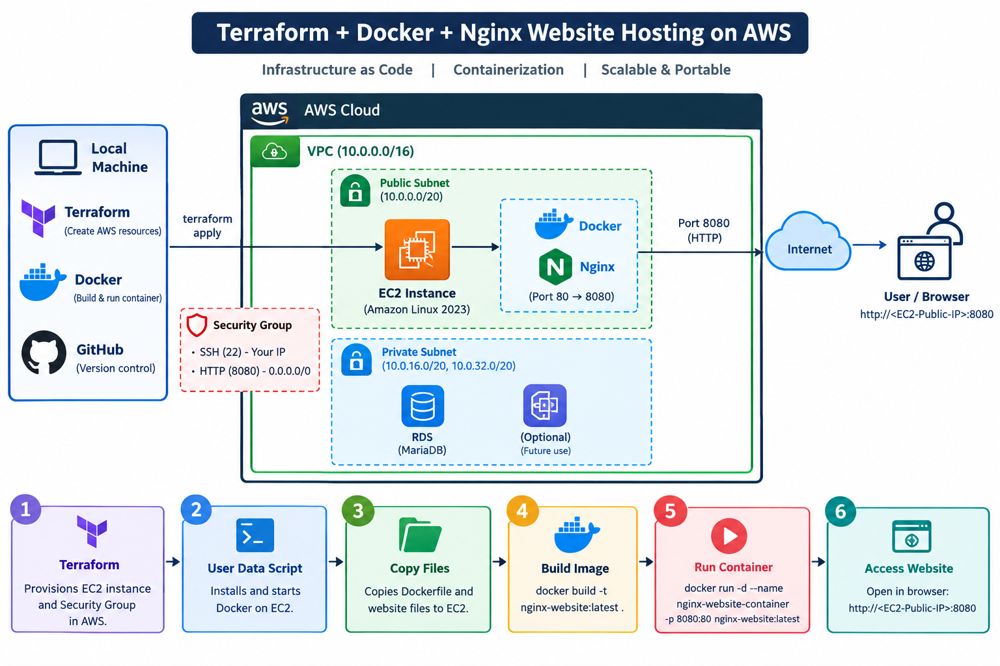

# Terraform + Docker + Nginx Website Hosting on AWS

## Project Overview

This project demonstrates how to provision an AWS EC2 instance using Terraform and host a static website using Docker and Nginx.

The website is packaged into a Docker image and deployed as a container on an Amazon EC2 instance.

## Technologies Used

* **AWS EC2** – Cloud virtual server
* **Terraform** – Infrastructure as Code (IaC)
* **Docker** – Containerization
* **Nginx** – Web server
* **Amazon Linux 2023** – Operating system
* **HTML & CSS** – Website development
* **Git & GitHub** – Version control and project hosting

## Project Architecture



1. Terraform provisions an EC2 instance in AWS.
2. A Security Group allows SSH access and website traffic on port 8080.
3. User data installs and starts Docker on the EC2 instance.
4. Website files and the Dockerfile are copied to the EC2 instance.
5. A Docker image is built using the Nginx base image.
6. A Docker container runs the website on port 8080.
7. The website is accessed through the EC2 public IP address.

## Project Structure

```text
terraform-docker-nginx-website/
├── terraform/
├── docker/
├── website/
├── architecture.png
├── README.md
└── .gitignore
```

## Deployment Steps

### 1. Provision AWS Infrastructure

Initialize Terraform:

```bash
terraform init
```

Validate the configuration:

```bash
terraform validate
```

Preview the infrastructure changes:

```bash
terraform plan
```

Create the EC2 instance:

```bash
terraform apply
```

### 2. Install and Configure Docker

Docker is installed and started on the EC2 instance using the Terraform user data script.

### 3. Build the Docker Image

Copy the Dockerfile and website files to the EC2 instance, then navigate to the website directory.

Build the image:

```bash
docker build -t nginx-website:latest .
```

### 4. Run the Container

```bash
docker run -d --name nginx-website-container -p 8080:80 nginx-website:latest
```

### 5. Verify the Deployment

Check the running container:

```bash
docker ps
```

View the container logs:

```bash
docker logs nginx-website-container
```

Access the website using:

```text
http://<EC2-PUBLIC-IP>:8080
```

Replace `<EC2-PUBLIC-IP>` with the public IP address of your EC2 instance.

## Security Considerations

* Restrict SSH access to your own public IP address.
* Allow inbound TCP port 8080 when public website access is required.
* Never commit private keys, AWS credentials, Terraform state files, or secret variable files to GitHub.
* Review AWS resources and costs after deployment.

## Learning Outcomes

* Provisioning AWS infrastructure using Terraform.
* Configuring EC2 instances and Security Groups.
* Installing Docker on Amazon Linux.
* Building custom Docker images.
* Running and troubleshooting Docker containers.
* Hosting a static website using Nginx.
* Using Git and GitHub for version control.

## Author

**Sanket Daingade**

[GitHub](https://github.com/sanketdaingade) | [LinkedIn](https://www.linkedin.com/in/sanketdaingade/)
